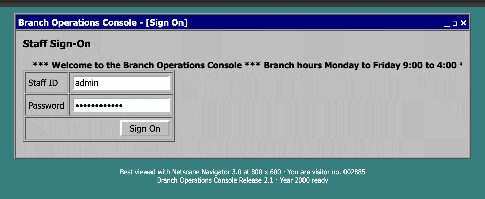

<p align="center">
  
</p>

# Legacy Goat

### Intentionally Vulnerable Legacy Language Application

Legacy Goat is a small core-banking application written in COBOL, Fortran, Object Pascal, SAS and
ABAP, with security flaws planted on purpose. It exists for testing and training: point a scanner
or a reviewer at code in languages that modern security tools rarely read, and measure what they
find against a published answer key.

Run it only in a lab. The services speak plain HTTP, and the lab configuration publishes every port
with throwaway credentials.

## How it is built

A teller signs on to an Object Pascal console in a browser. It serves period HTML forms in the
style of a 1990s Delphi application, and every business operation goes through a C++ gateway to the
module that owns it:

| Module | Language | What it does |
|---|---|---|
| [cobol/](cobol/) | COBOL (GnuCOBOL with embedded SQL) | System of record: double-entry postings to the SQL ledger, the VSAM account master, customer segments in IMS DL/I |
| [fortran/](fortran/) | Fortran | Transfer fees and interest |
| [pascal/](pascal/) | Object Pascal (Free Pascal, Delphi mode) | The operator console and its sessions |
| [sas/](sas/) | SAS | Posting reports read from the ledger |
| [abap/](abap/) | ABAP | General-ledger documents in the ERP |

The teller can post funds transfers, take cash deposits and pay out withdrawals, look up an account,
print its statement, and (as a supervisor) freeze or unfreeze it. A transfer that posts crosses all
five modules and three kinds of storage: SQL, an indexed VSAM file, and a hierarchical DL/I
database. Every value that crosses a module boundary is defined once in [contracts/](contracts/),
as JSON Schema for the REST hops and as copybooks and record layouts for the native ones.

The runtime images, the C/C++ adapters and gateway, the databases and the test harness live in
[legacy-goat-runtimes](https://github.com/Octane-Security/legacy-goat-runtimes).

## How it is vulnerable

Sixteen flaws are planted across fifteen weakness classes, each written in the idiom of the
language it lives in:

- COBOL: SQL injection in the staff sign-on, DL/I SSA injection, an out-of-bounds table read, a
  negative-amount transfer, a missing branch check, and a hardcoded password salt
- Pascal console: a forgeable session token, reflected XSS, XXE, SSRF, path traversal, and passwords
  in the log
- SAS: OS command injection and SQL injection through PROC SQL pass-through
- Fortran: integer overflow in the fee arithmetic
- ABAP: unescaped output in the GL response

Most of the flaws sit behind deployment settings, so whether one is exploitable depends on how the
app is deployed. The runtimes define two profiles. Under `baseline` every setting keeps its
default, and only two flaws can be exploited; the rest are present in the code but unreachable.
Under `permissive` every setting is flipped, and fifteen can be exploited (the hardcoded salt is a
static finding under both). The answer key grades every flaw per profile. A scanner earns credit for telling a reachable
flaw from a dormant one and loses it for reporting dormant ones as live.

The answer key is [benchmark/manifest.yaml](benchmark/manifest.yaml): each flaw's location,
weakness class and CWE, per-profile grade, and fix. [benchmark/](benchmark/) also holds the
ground-truth SARIF per profile and a step-by-step exploit recipe for every exploitable grade. The
runtimes repository has a runnable proof for each exploitable flaw and a scorer that compares a
scanner's SARIF with the ground truth.

## Branches

| Branch | Contents |
|---|---|
| `main` | The application, the answer key in `benchmark/`, and the tooling that builds the other two branches |
| `vulnerable` | The application source alone, byte for byte as on `main`, with nothing that points at a flaw. Scan this one. |
| `fixed` | The same source with every planted flaw fixed. It behaves the same as `vulnerable` on legitimate input, so it serves as a negative control. |

CI rebuilds `vulnerable` and `fixed` from `main` on every push. The diff between the two points at
every flaw, so give a scanner only one of them, and score its findings against `main`.

## Running it

This repository holds the application source. Its companion,
[legacy-goat-runtimes](https://github.com/Octane-Security/legacy-goat-runtimes), runs it: it builds
a runtime image for each language, compiles this source as the containers start, and brings up the
gateway, the databases, the test suites and the exploit proofs. You need Docker with Compose, or
Podman with `podman compose`, plus `curl`, `python3` and [uv](https://docs.astral.sh/uv/) for the
tests. Check out both repositories side by side:

```sh
git clone https://github.com/Octane-Security/legacy-goat.git
git clone https://github.com/Octane-Security/legacy-goat-runtimes.git
cd legacy-goat-runtimes
make up-build APP_PROFILE=permissive   # builds the images on first run; the COBOL one takes a while
make verify APP_PROFILE=permissive     # functional tests, then every exploit proof against the answer key
```

Then open <http://localhost:8085/> and sign on as teller `TLR001` with password `teller-pw`, or as
supervisor `SUP001` with `super-pw`:



[docs/exercising-the-app.md](https://github.com/Octane-Security/legacy-goat-runtimes/blob/main/docs/exercising-the-app.md)
walks through every feature.

## Layout

```
cobol/       core ledger, account master, DL/I customer access
fortran/     fee and interest numerics
pascal/      operator console service
sas/         reporting connector jobs
abap/        GL integration (ICF handler class)
contracts/   REST/JSON contracts, copybooks and record layouts
benchmark/   answer key: manifest, ground-truth SARIF, exploit recipes (main only)
tooling/     builds and checks the vulnerable and fixed branches (main only)
```

## Contributing

Octane Security maintains Legacy Goat and its runtimes, and we welcome pull requests from the
security community. New flaws, languages and banking features, sharper exploit proofs, and fixes to
anything that is broken all make Legacy Goat a better benchmark for everyone. If you find a flaw we
did not plant, send a pull request that adds it to the answer key or fixes it.

Open pull requests against `main`; CI rebuilds `vulnerable` and `fixed` from it. The application
source has to stay blind, with no comment, name or string that points at a flaw. A new flaw needs an
answer-key entry (see [benchmark/README.md](benchmark/README.md)), a fix in
[tooling/fix_apply.py](tooling/fix_apply.py), and a proof under `triggers/` in legacy-goat-runtimes.
Run `python3 tooling/test_gate.py` before you push; [tooling/README.md](tooling/README.md) explains
what it checks.

## License

Copyright (C) 2026 Octane Security.

Legacy Goat is free software: you can redistribute it and/or modify it under the terms of the GNU
General Public License, version 3, as published by the Free Software Foundation. It is distributed
WITHOUT ANY WARRANTY. See [LICENSE](LICENSE).
